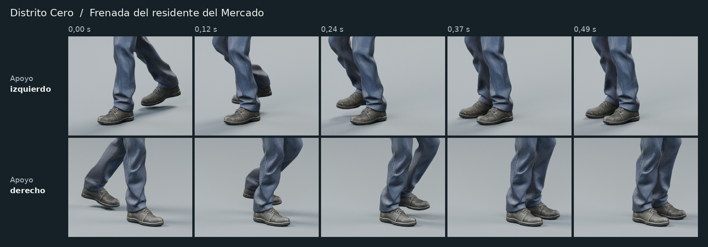

# El último paso del residente del Mercado

Antes de dar media vuelta, el residente apoya un pie y reúne el otro a su lado. La malla de Higgsfield lleva dos frenadas sobre el mismo rig de 49 huesos. **FrenadaL** sale de la marcha al 15 % del ciclo, con el apoyo en el pie izquierdo. **FrenadaR** sale al 65 %, con el apoyo en el derecho. Cada toma dura 0,490 s. El avance de 16,53 cm está integrado en el GLB. [Modelo animado](character-walk.glb).



En la lámina, cada fila usa una cámara fija situada al lado del pie que sostiene el cuerpo. Se aprecia cómo el zapato del fondo viaja hasta su posición final mientras el del primer plano permanece apoyado. Las imágenes proceden de la escena de Blender.

## Revisar las dos tomas

Abrir `character-motion.blend` y usar la marca del fotograma **273** para el apoyo izquierdo o la del **298** para el derecho. La primera toma termina en el fotograma 284,76 y la segunda en el 309,76. Ambas mantienen la postura final durante medio segundo para poder inspeccionar la colocación de los talones. En Propiedades de escena se pueden seleccionar las cámaras **Estudio · apoyo izquierdo** y **Estudio · apoyo derecho**.

En el editor NLA, la pista **Giro y frenadas** contiene tres tiras que se pueden seleccionar y editar por separado. Las marcas anteriores de marcha, reposo, carrera y giro siguen en los fotogramas 1, 75, 171 y 226. [Escena y referencias del giro](giro-estudio.md).

## Reconstruir y verificar

Desde la raíz del repositorio, usar Blender 4.3.2, Python con Pillow y la fuente DejaVu Sans. El directorio de salida debe ser nuevo. Omitiendo `--brake-frames` se genera sólo la escena editable.

```sh
modelo=assets/higgsfield-20261125/character-walk.glb
estudio=artifacts/estudio-frenada
blender -b -t 2 --python-exit-code 1 -P tools/review_higgsfield_motion.py -- "$modelo" "$estudio" --brake-frames
blender -b -t 2 "$estudio/character-motion.blend" --python-exit-code 1 -P tests/higgsfield_motion_studio.py -- --brakes
python3 tools/compose_higgsfield_braking.py "$estudio" "$estudio/residente-frenada.jpg"
```

La comprobación reabre la escena, comprueba las tres texturas 4K empaquetadas y compara los 49 huesos de cada toma con la fase de entrada en marcha y con la postura final de reposo trasladada. También comprueba que ambos zapatos caben en los diez encuadres de la lámina.
