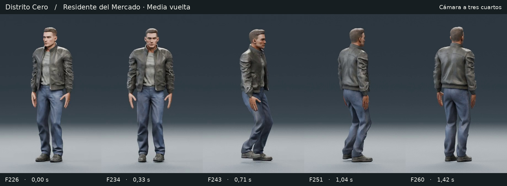

# Media vuelta del residente del Mercado

La acción **Giro** dura 1,4 s. El residente cambia de apoyo, gira 180° en el sitio y termina de espaldas a la cámara. En el GLB se puede seleccionar la acción por nombre y reproducirla una vez. [Modelo animado](character-walk.glb).



## Revisar y editar en Blender

Abrir `character-motion.blend` del paquete de autoría. En la línea de tiempo, situar el cursor en el fotograma **226**. Pulsar **Espacio** para ver la media vuelta. El vídeo `giro-oblicua.mp4` del paquete reproduce ese tramo con el encuadre fijo de cuerpo entero. El último medio segundo permite inspeccionar la colocación de ambos zapatos.

| Marca | Fotograma inicial | Acción |
| --- | ---: | --- |
| Marcha | 1 | Cuatro ciclos |
| Reposo | 75 | Una respiración |
| Carrera | 171 | Cuatro ciclos |
| Giro | 226 | Una media vuelta |
| Fin del giro | 260 | Mantener la orientación final hasta el fotograma 272 |

A 24 fps, la última clave de **Giro** cae en el fotograma 259,6. Su tira NLA usa una repetición y prolonga la última pose. Las cuatro tiras se pueden editar por separado. La cámara **Estudio · oblicua** muestra la silueta completa y el contacto con el suelo. En **Propiedades de escena**, cambiar la cámara a **Estudio · perfil** para examinar un apoyo lateral. Para editar el esqueleto, seleccionar el rig y activar las superposiciones del visor. [Modelado, rig y ciclos previos](body-motion.md).

## Reconstruir y comprobar

Ejecutar las órdenes con Blender 4.3.2 desde la raíz del repositorio. La receta crea el directorio de salida.

```sh
modelo=assets/higgsfield-20261125/character-walk.glb
estudio=artifacts/estudio-giro

blender -b -t 2 --python-exit-code 1 -P tools/review_higgsfield_motion.py -- "$modelo" "$estudio" --turn-preview
blender -b -t 2 "$estudio/character-motion.blend" --python-exit-code 1 -P tests/higgsfield_motion_studio.py
```

La primera orden guarda la escena con la malla, el rig y los tres mapas de 4096 × 4096 píxeles. También renderiza en Cycles el MP4 de 464 × 576 píxeles, 24 fps y 47 fotogramas. Para generar solo la escena, omitir `--turn-preview`.

La segunda orden reabre el archivo guardado. Comprueba que las poses de las tiras coinciden con las acciones individuales, que las claves de ambos índices siguen editables y que las tres texturas están empaquetadas. Recorre el giro fotograma a fotograma, comprueba que el cuerpo entero cabe en la cámara y compara la pose retenida con la última clave en los 49 huesos.

La [receta de la referencia y las dos cámaras](body-motion.md#reproducción-del-modelo-vigente) admite también este GLB. Con la opción `--frames`, añade cinco fases de **Giro** en cada vista, incluidos el inicio y la orientación final.
