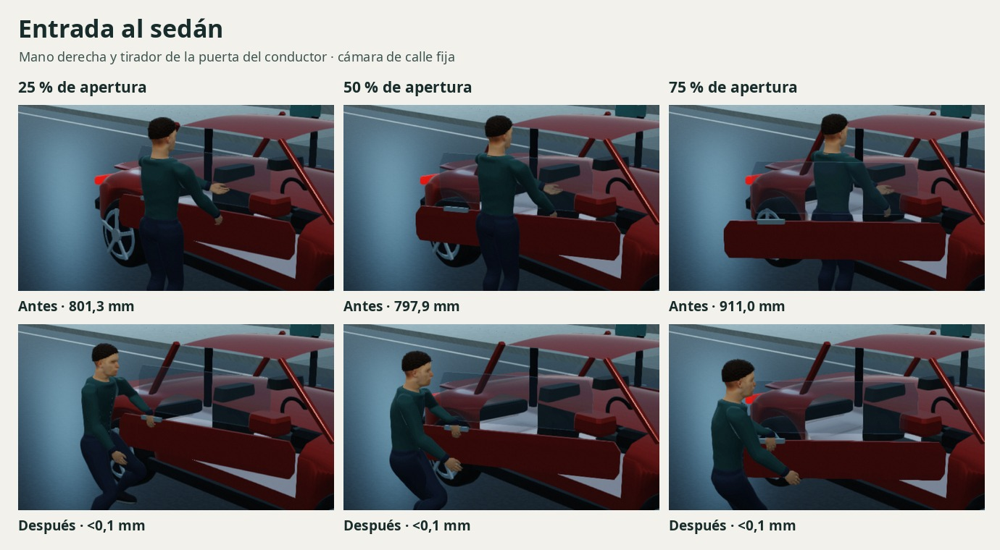

# Contacto de la mano al abrir el sedán



La referencia corresponde a `e2e383c` y la captura corregida a `5f57531`. Las seis imágenes muestran al mismo conductor entrando por la puerta izquierda de un sedán estacionado y vacío. La cámara y la semilla son fijas. Cada columna compara el mismo porcentaje de apertura física. El cuerpo y la puerta avanzan con el controlador de acceso jugable desde `sim.startAccess()`.

Al 25, 50 y 75 % de apertura, las separaciones de referencia son 801,3, 797,9 y 911,0 mm. Tras el ajuste, las tres quedan por debajo de 0,1 mm. Chromium dibujó la escena con WebGL2 y SwiftShader.

La distancia indicada se mide en tres dimensiones desde el punto central de la palma derecha, deformado por el esqueleto que utiliza el renderer, hasta el centro de la cara exterior del tirador dibujado. El muestreo cubre tres instantes de la apertura. Los dedos individuales y sus colisiones quedan fuera de esta medición.

## Reproducción

Con Playwright y Chromium WebGL2 instalados, ejecutar desde la raíz del repositorio. Si se usa un Chromium del sistema, definir `DC_QA_BROWSER` con su ruta. Los directorios de salida deben estar libres.

```sh
mkdir -p artifacts/boarding-hand
git show e2e383c:index.html > artifacts/boarding-hand/antes.html
python3 tools/qa/capture_boarding_hand.py --html artifacts/boarding-hand/antes.html --output artifacts/boarding-hand/antes
python3 tools/qa/capture_boarding_hand.py --html index.html --output artifacts/boarding-hand/despues --require-contact
python3 tools/qa/capture_boarding_hand.py --html index.html --output artifacts/boarding-hand/secuencia --motion
```

La captura genera tres PNG y sus medidas, comprueba que la palma quede a menos de 6 mm en cada muestra corregida y verifica que la partida activa conserve su estado. El modo de vídeo requiere FFmpeg y sigue al conductor desde la reserva hasta el asiento, con tres actualizaciones de simulación de 1/60 s por fotograma.

[Vídeo de referencia](antes.mp4) · [Vídeo corregido](despues.mp4)

[Mediciones antes](antes.json) · [Mediciones después](despues.json) · [Fases del vídeo de referencia](antes-secuencia.json) · [Fases del vídeo corregido](despues-secuencia.json)
