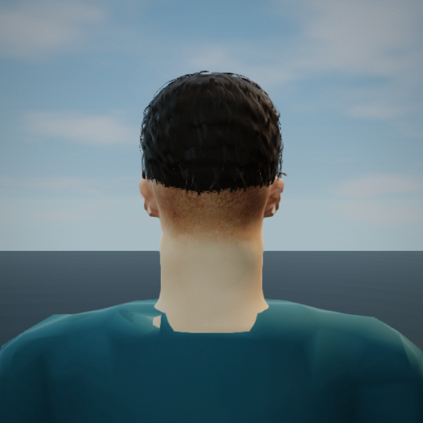
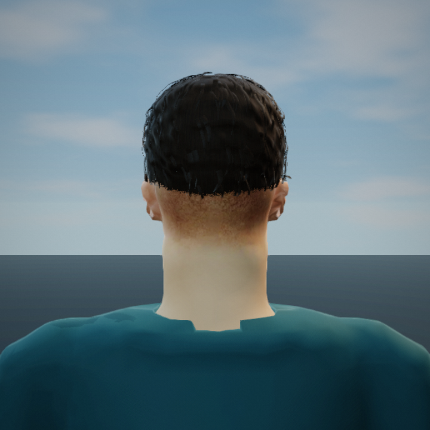
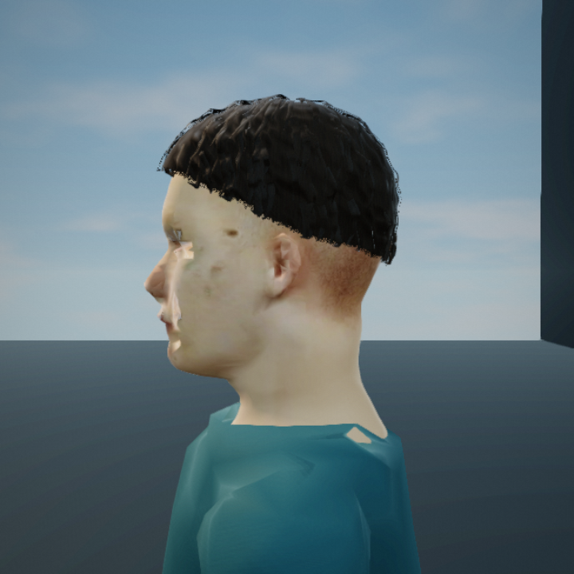
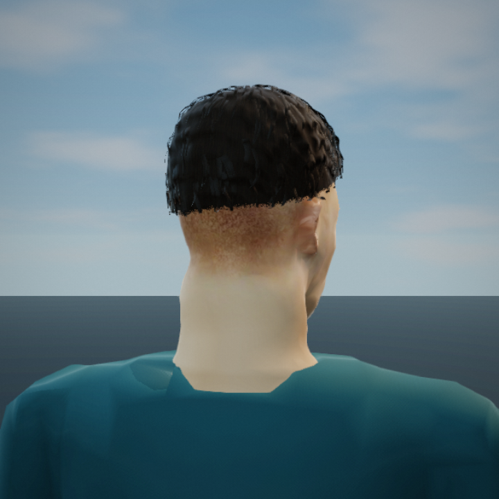
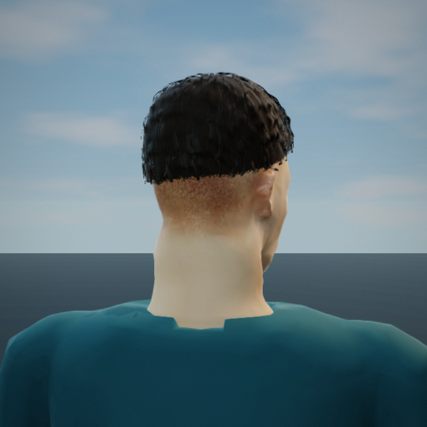
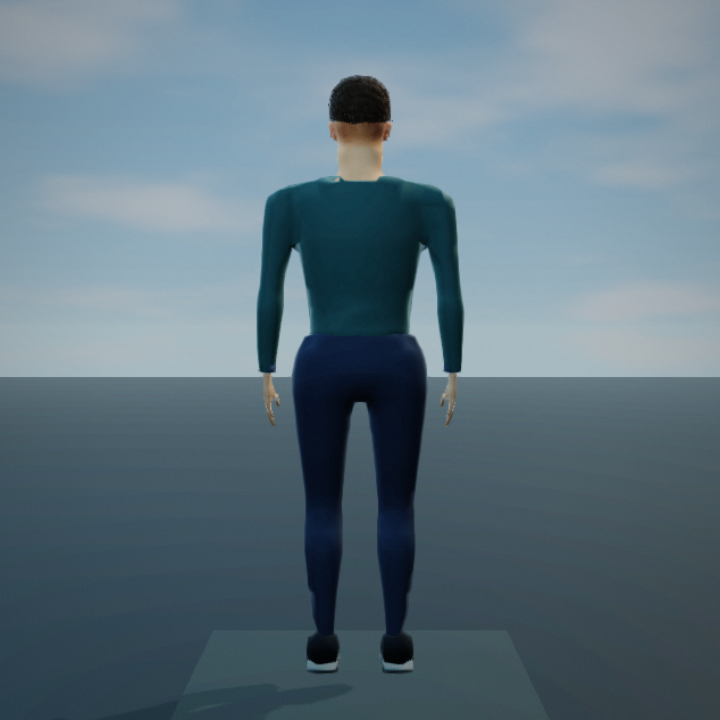
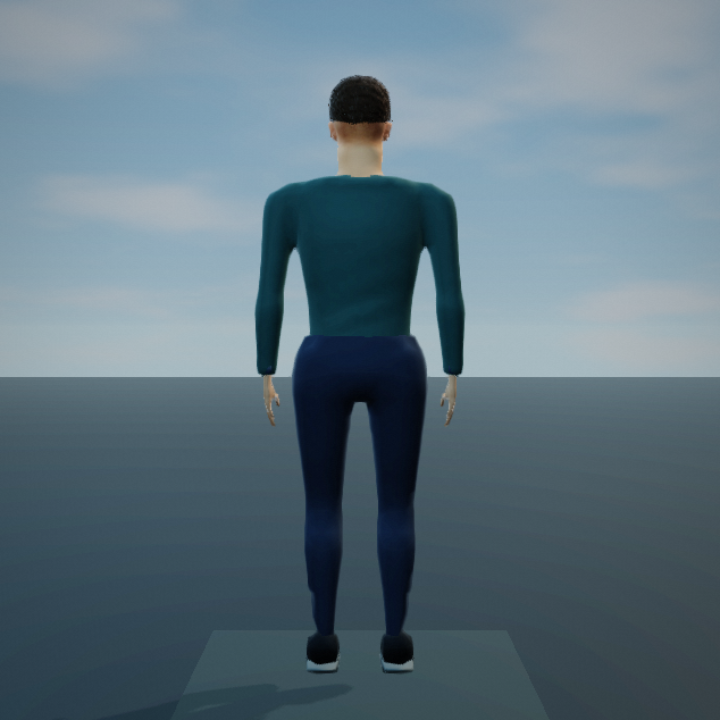

# Chaqueta LOD2 · candidata v0.20.25

Cuatro pares originales seleccionados de **84 capturas completas** (42 antes y
42 después). [Contrato y reproducción](../../docs/project/COLLAR-LOD.md) ·
[Mediciones, hashes y procedencia](summary.json).

El candidato reutiliza la chaqueta LOD1 para LOD2. Aprueba **173 controles de
captura y 110 criterios geométricos**; el comparador aprueba **304/304**.
Las 24 capturas LOD0/1 son idénticas y la geometría GPU de la piel se conserva
en las 42 vistas. La baseline completa sus capturas y reproduce 44 criterios
geométricos fallidos.

| Muestra | Antes · v0.20.24 | Después · v0.20.25 |
| :--- | :--- | :--- |
| Neutro · nuca · LOD2 |  |  |
| Neutro · perfil · LOD2 |  |  |
| Robusto · cuello a la derecha · LOD2 |  |  |
| Neutro · cuerpo completo posterior · LOD2 |  |  |

## Cobertura y límites

La cohorte contiene **611 anclas fuente**. Se evalúan cuatro perfiles por tres
poses: las **3.755 combinaciones condición-ancla** del subconjunto cubierto en
LOD0 y LOD1 no son 3.755 anclas únicas. Sus pérdidas bajan **714 → 0**.

El conjunto completo cubierto en LOD0 suma **4.596 combinaciones**: sus pérdidas
bajan **1.365 → 841**. Se conserva la deuda de cobertura de LOD1. Además, **190
combinaciones fuera del subconjunto LOD0/1**, cubiertas por la chaqueta LOD2
anterior, dejan de estar cubiertas al reutilizar LOD1. El balance neto es de
524 pérdidas menos; **no mejora cada ancla**. Los [IDs y recuentos completos](fullsource-coverage-final.json) preservan ese intercambio.

| Condición | Subconjunto LOD0/1 | Pérdidas subconjunto antes → después | Pérdidas fuente antes → después | Deuda LOD1 | Nuevas pérdidas fuera del subconjunto | Márgenes negativos después | UNKNOWN después |
| :--- | ---: | ---: | ---: | ---: | ---: | ---: | ---: |
| neutral/idle | 289 | 59 → 0 | 119 → 78 | 78 | 18 | 1 | 40 |
| neutral/neck-left | 284 | 56 → 0 | 107 → 67 | 67 | 16 | 0 | 40 |
| neutral/neck-right | 283 | 55 → 0 | 108 → 69 | 69 | 16 | 0 | 40 |
| light/idle | 294 | 64 → 0 | 117 → 69 | 69 | 16 | 0 | 38 |
| light/neck-left | 290 | 63 → 0 | 114 → 66 | 66 | 15 | 1 | 38 |
| light/neck-right | 292 | 64 → 0 | 113 → 62 | 62 | 13 | 1 | 38 |
| robust/idle | 310 | 53 → 0 | 134 → 98 | 98 | 17 | 0 | 43 |
| robust/neck-left | 322 | 53 → 0 | 115 → 74 | 74 | 12 | 0 | 43 |
| robust/neck-right | 320 | 53 → 0 | 116 → 75 | 75 | 12 | 1 | 43 |
| extreme/idle | 370 | 70 → 0 | 115 → 63 | 63 | 18 | 0 | 43 |
| extreme/neck-left | 354 | 62 → 0 | 99 → 56 | 56 | 19 | 0 | 43 |
| extreme/neck-right | 347 | 62 → 0 | 108 → 64 | 64 | 18 | 1 | 43 |

Permanecen **cinco márgenes direccionales negativos**: −0,075143; −0,011387;
−0,195929; −0,007299 y −0,046330 mm. Cuatro son nuevos frente a la chaqueta
LOD2 anterior y el quinto tenía referencia anterior desconocida. No se descartan
por su pequeño tamaño. Hay **492 sondas sin impacto de piel LOD2**, 38–43 por
condición: se clasifican como **UNKNOWN**, nunca como ausencia de intersección.
El JSON conserva también los negativos, desconocidos y mínimos anteriores por
condición. Las sondas no miden volumen de colisión ni área visible exacta.

## Coste y evidencia completa

Por actor LOD2 se añaden **2.181 triángulos**. Con peinado neutro, el total pasa
de **6.925 a 9.106 (+31,5 %)**. Compartir la malla existente elimina el VBO
anterior de **155.712 bytes**, un buffer de instancias, un VAO y su reducción;
no representa memoria GPU total ni una promesa de FPS.

El paquete `distrito-cero-v0.20.25-revision.zip`, facilitado en la entrega,
conserva las 84 imágenes originales, geometría GPU, informes y comparadores.
Las siguientes son rutas **dentro del paquete**, no enlaces a archivos ignorados
del checkout:

- `evidencia/before-final/report.json` y `evidencia/after-final/report.json`.
- `evidencia/collar-comparison-final.json` y `evidencia/final-qa-freeze.json`.
- `evidencia/skin-clearance-before-final.json`, `evidencia/skin-clearance-after-final.json`
  y `evidencia/skin-clearance-comparison-final.json`.
- `evidencia/skin-clearance-crops-final.png` y `evidencia/audit_skin_clearance.py`.

Los informes se capturaron antes del commit candidato; sus campos de commit
apuntan a la base. Los hashes del HTML y del productor en `summary.json`
identifican exactamente los bytes evaluados. Las ocho imágenes de esta galería
son copias sin cambios, verificadas contra los informes originales.

Son poses y vistas preparadas, no animación continua, playtest ni evaluación
física de GPU. No se certifican ausencia global de intersecciones, anatomía,
calidad AAA ni cierre de #5/#6/#7.
