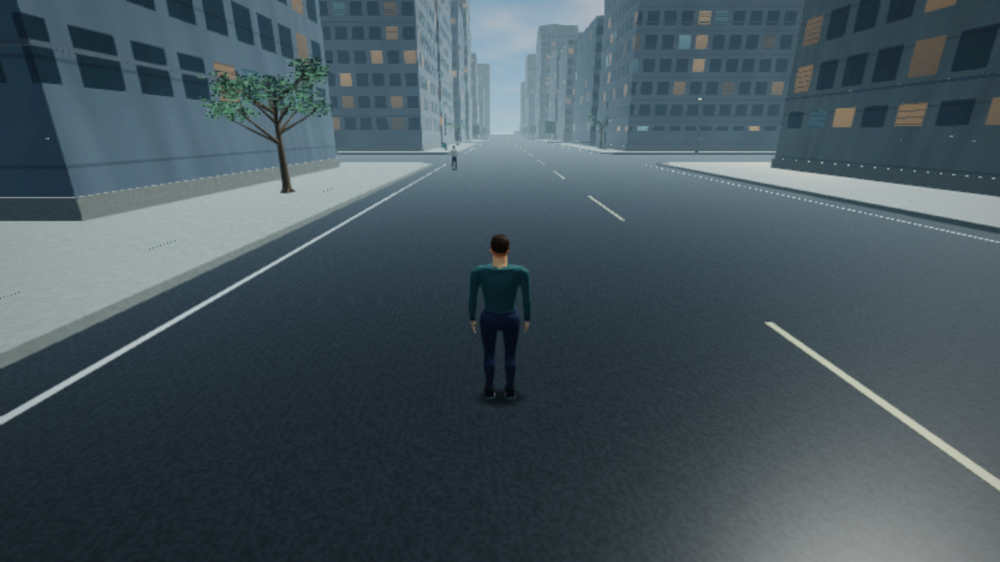

# La chaqueta en la cámara de calle

Con la cámara habitual a pie, el peatón ocupa aproximadamente 21 píxeles de alto al entrar en LOD2 en la muestra equilibrada y 31 en la económica. La chaqueta cambia el sombreado y contorno del torso. La resolución de estos fotogramas deja sin distinguir los márgenes individuales del cuello medidos en los primeros planos.



Comparación de v0.20.24, commit `2b72a688`, con v0.20.25 integrada en `ba9997df`. Se usaron la misma calle, semilla 1337, tiempo de simulación 1,25 s, un peatón de variante 0 y un viewport de 1280 × 720 con DPR 1. El desplazamiento lateral del peatón de 3,5 m permite verlo junto al jugador. La simulación conserva las coordenadas del jugador y la cámara calcula su posición con el método de seguimiento a pie. El renderer selecciona los niveles de detalle por distancia al jugador e historial. Para la comprobación de visibilidad se repite cada fotograma ocultando sólo al peatón y se contrasta la región del cuello. Los hashes de imagen, las posiciones proyectadas y los límites de los cambios figuran en [el informe de calle](street.json).

| Perfil | Separación longitudinal | Distancia efectiva al jugador | LOD observado | Píxeles RGB distintos en pantalla |
| --- | ---: | ---: | ---: | ---: |
| Equilibrado | 42 m | 42,15 m | 1 | 0 |
| Equilibrado | 50 m | 50,12 m | 2 | 54 |
| Económico | 24 m | 24,25 m | 1 | 0 |
| Económico | 31 m | 31,20 m | 2 | 179 |

Los píxeles distintos corresponden al personaje vestido completo. El total incluye iluminación y filtrado. No proporciona un recuento de píxeles de piel expuesta. Son cuatro encuadres de un peatón inmóvil en Chromium con SwiftShader. El coste de GPU física y la inspección en movimiento siguen abiertos.

## Qué cambia al acercar la cámara

Al proyectar las 190 combinaciones que perdieron cobertura de chaqueta se encuentran 76 centros de píxel distintos al contar el par condición–píxel que pasan de prenda a piel en el primer plano posterior y ocho en el perfil. El ancla 9216 en reposo neutro localiza un caso en el borde lateral. También se revisaron las 492 sondas que no alcanzaban piel en su dirección original. Un impacto en otra superficie al mirar desde la cámara deja desconocido el resultado de esa sonda. En las tres cámaras de cuerpo completo analizadas, la chaqueta queda delante en las 682 combinaciones. Estos cálculos usan las superficies de piel y prenda extraídas del shader.

## Reproducir la calle

Desde un checkout con los requisitos de QA instalados, usar Chromium de Playwright o definir `DC_QA_BROWSER` con la ruta a un Chromium local.

```sh
mkdir -p artifacts/review-inputs
git show 2b72a688:index.html > artifacts/review-inputs/before.html
git show ba9997df:index.html > artifacts/review-inputs/after.html
python3 tools/qa/capture_collar_street.py --before artifacts/review-inputs/before.html --after artifacts/review-inputs/after.html --output artifacts/collar-street-replay
```

El comando conserva los ocho PNG y el informe en una carpeta nueva. La base histórica registra la cohorte, las cinco mediciones negativas y los 190 cambios de cobertura por identificador. [Contrato de la chaqueta](../../docs/project/COLLAR-LOD.md).

Para reproducir el análisis geométrico, extraer el paquete de revisión v0.20.25 y usar su carpeta `evidencia/`. El [resumen de proyección](../collar-visibility-v02025/summary.json) conserva los recuentos por cámara y las huellas de entrada.

```sh
evidence=/ruta/al/paquete/evidencia
python3 tests/collar_visibility.test.py
python3 tools/qa/project_collar_visibility.py \
  --before-report "$evidence/before-final/report.json" \
  --after-report "$evidence/after-final/report.json" \
  --coverage-report "$evidence/fullsource-coverage-final.json" \
  --clearance-report "$evidence/skin-clearance-after-final.json" \
  --output artifacts/collar-geometria-replay.json
```
