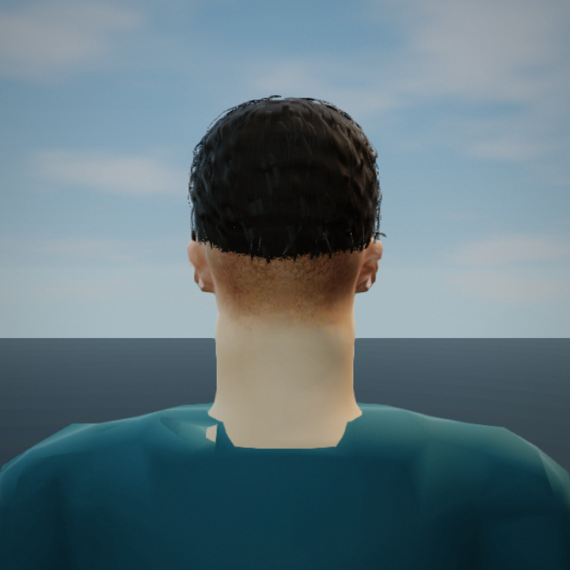
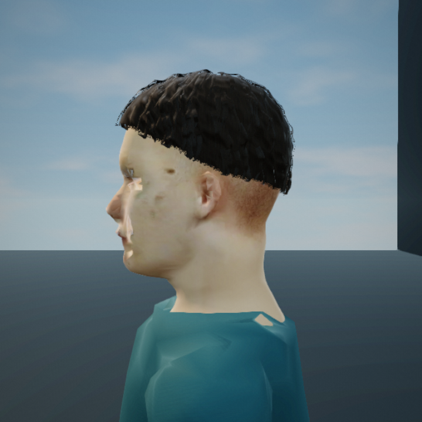
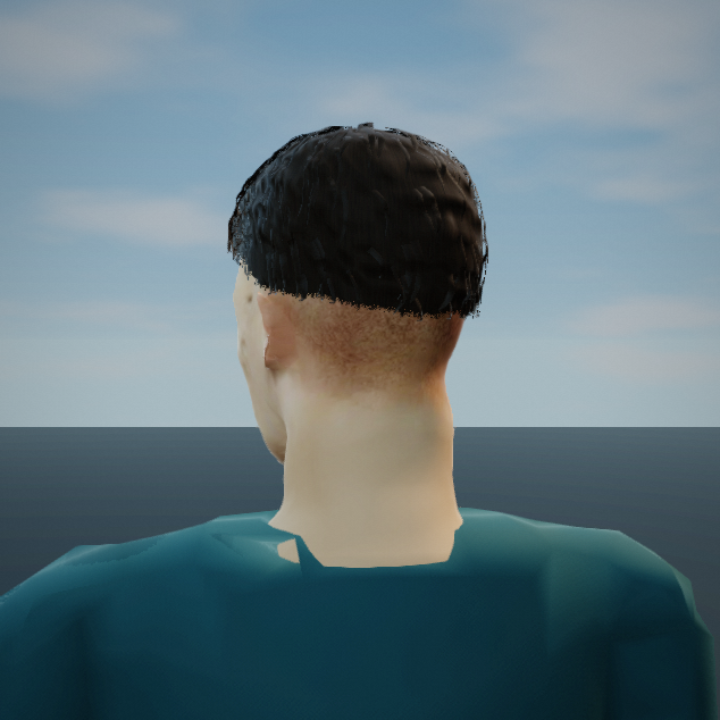
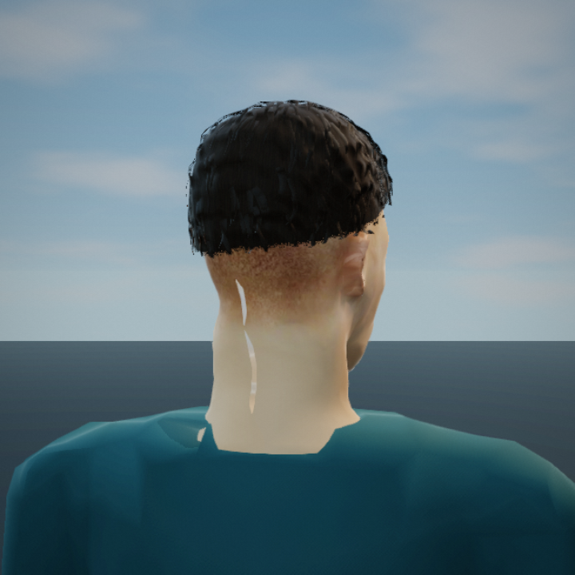

# Continuidad cervical · candidata v0.20.24

Cuatro pares seleccionados de las 16 vistas completas del renderer nativo.
[Contrato y reproducción](../../docs/project/LOD-SEAM-CONTINUITY.md),
[mediciones y procedencia](summary.json). Las capturas corresponden al HTML
`50b5123b8dcbe27182e63eab5fe9d2647ddc73c5d080fb21e77adae5cb8f4de1`.

La baseline tiene 36 controles de captura aprobados y 13 criterios geométricos
fallidos. El candidato aprueba 53 controles de captura y 37 criterios geométricos.
Las cuatro vistas LOD0/1 de la comparación completa son idénticas píxel por píxel.
La fisura posterior desaparece; el parche del collar persiste como otro defecto.

| Muestra | Antes · 0.20.23 | Después · 0.20.24 |
| :--- | :--- | :--- |
| idle--neutral--back--body-lod2 |  |  |
| idle--neutral--profile--body-lod2 |  |  |
| neck-sequence-02 |  |  |
| neck-sequence-07 |  |  |

Las diez poses de cuello son muestras DQ preparadas, no animación continua ni
una prueba de FPS. El paquete de revisión conserva las 32 imágenes, geometría
GPU, informes y comparador; el artefacto de CI conserva la corrida de su commit.
Los informes locales registran el HEAD anterior al commit del candidato; los
hashes del HTML y del productor identifican exactamente lo medido. No se atribuye
calidad AAA ni cierre global de #5/#6/#7 a estos resultados.
