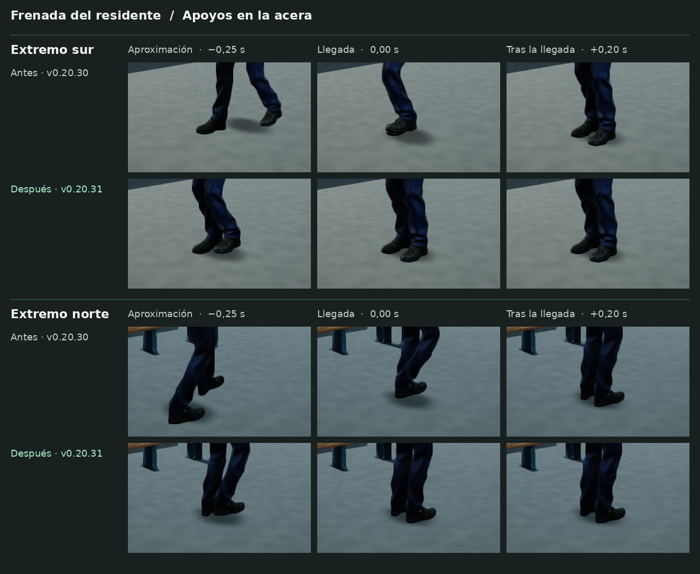

# Frenada del residente del Mercado

[Ver el último paso en movimiento](frenada.mp4) · [Comparar los dos extremos desde la cámara lejana](distancia.jpg)



En v0.20.30 el residente llegaba a la esquina a velocidad de marcha. La transición a reposo recolocaba el zapato que soportaba el peso después de que la raíz del actor se hubiese detenido. En v0.20.31 el movimiento de raíz y la animación desaceleran juntos en los últimos 16,5 cm. En el trayecto hacia Z = 149 sostiene el peso con el pie derecho y, al volver a Z = 130, con el izquierdo.

## Cámara y medición

La simulación con semilla 1337 lleva el coche inicial al Taller del Mercado. Se registra al residente `ped:38` mientras camina por su ruta normal. Una primera pasada localiza el tick de llegada por el cambio de destino y el inicio de la espera de 2,4 s. La segunda repite la simulación, mantiene la cámara fija y toma 217 muestras por extremo, a 60 Hz, desde 1,2 s antes de la llegada hasta 2,4 s después. La comparación alinea el tick de llegada en las dos versiones. La frenada amplía la duración de cada trayecto en aproximadamente 0,37 s.

El renderizador selecciona la malla cercana a 2,81 m del residente en planta y la reducida a 24,35 m. En cada malla se leen los vértices y pesos del búfer WebGL, las matrices de piel de su fila y la transformación que usa la instancia del juego. Las alturas se expresan sobre el pavimento del residente. El vídeo recoge cada tercer tick entre −0,60 s y +0,50 s de la llegada y los reproduce a velocidad ×0,75. Las dos cámaras lejanas se registran a +0,10 s. Se utilizó Chromium con SwiftShader.

Para cada pie se escogen dos vértices materiales fijos de la suela. En la pose de enlace, se toma el vértice más bajo del 20 % posterior del dibujo de la suela para el talón y el más bajo del 20 % anterior para la puntera. La selección se hace una sola vez por malla y es idéntica en ambas versiones. La huella de contacto se comprueba además siguiendo el centro de la zona inferior de 15 mm del zapato, que ya se usaba en la medición de v0.20.30. Los informes incluyen las coordenadas de enlace de los cuatro marcadores.

## Contacto contra el pavimento

Máxima excursión horizontal del marcador dentro de un episodio continuo a 10 mm o menos del pavimento. Valores en milímetros.

| Ventana y marcador | v0.20.30 | v0.20.31 |
| --- | ---: | ---: |
| Aproximación completa, −1,2 s a la llegada · talón o puntera | 37,185 | 37,470 |
| Espera antes del giro, 0 a +0,5 s · talón o puntera | 55,585 | <0,001 |
| Misma espera · centro de la suela con algún punto del zapato en contacto | 55,584 | <0,001 |

Durante las 29 muestras activas de la nueva frenada y la llegada se sigue continuamente el marcador del pie portante, independientemente de su altura. La altura de vuelo usa la menor coordenada vertical de la superficie completa del otro zapato. Valores en milímetros.

| Malla y destino | Pie de apoyo | Excursión del talón | Excursión de la puntera | Elevación del otro zapato |
| --- | --- | ---: | ---: | ---: |
| LOD0 · esquina Z = 149 | Derecho | 0,002 | 0,002 | 81,34 |
| LOD0 · marquesina Z = 130 | Izquierdo | 0,002 | 0,002 | 81,67 |
| LOD1 · esquina Z = 149 | Derecho | 0,002 | 0,002 | 84,41 |
| LOD1 · marquesina Z = 130 | Izquierdo | 0,002 | 0,002 | 81,65 |

Para el último paso se busca el pie con menor separación media del suelo en la superficie deformada. Se contrastan la altura y el movimiento continuo de sus dos marcadores durante los 29 intervalos finales con la acción seleccionada por el juego. El otro pie describe el paso de cierre. En las ventanas amplias se agrupan aparte los intervalos contiguos en los que cada marcador está a 10 mm o menos del suelo y se toma la mayor distancia horizontal entre dos muestras del grupo. Esta segunda medida incluye rodadura durante el despegue y el aterrizaje.

Empalme y continuidad. Al pasar de la última muestra de marcha a la primera de frenada, el máximo recorrido horizontal de un marcador del pie portante fue de 0,020 mm. Al entregar la pose al reposo, el máximo entre los cuatro marcadores fue inferior a 0,001 mm en ese tick.

La siguiente media vuelta conserva sus cinco apoyos y la espera en su extremo de ruta. La máxima excursión del centro del pie portante en cualquiera de sus cinco fases fue de 0,339 mm. Los datos caracterizan estas dos llegadas tranquilas. Las regresiones independientes de simulación cubren claxon y cadencias de actualización. El coste temporal en GPU física sigue pendiente.

## Reproducción

Se necesitan Python con Playwright y Pillow, Chromium, FFmpeg con libx264 y DejaVu Sans. La compilación anterior tiene SHA-256 `c29717f5178dfff47f0a63b93b26c7d350b1d4e1eaab2e9a307aa70027b0df05`. La nueva tiene SHA-256 `ed3324c77cf501ba91bad3079a0f787068dd2e6f655191cb0c2106a0fae5b268`.

```sh
mkdir -p artifacts/frenada
git show 74c6df7:index.html > artifacts/frenada/anterior.html
export DC_QA_BROWSER=/usr/bin/chromium
python3 tools/qa/capture_market_brake.py --html artifacts/frenada/anterior.html --output artifacts/frenada/antes
python3 tools/qa/capture_market_brake.py --html index.html --output artifacts/frenada/despues --require-braking --reference artifacts/frenada/antes/measurements.json
python3 tools/qa/capture_market_brake.py --html artifacts/frenada/anterior.html --output artifacts/frenada/antes-lod1 --far
python3 tools/qa/capture_market_brake.py --html index.html --output artifacts/frenada/despues-lod1 --far --require-braking --reference artifacts/frenada/antes-lod1/measurements.json
python3 tools/qa/compose_market_brake.py --before artifacts/frenada/antes --after artifacts/frenada/despues --far artifacts/frenada/antes-lod1 artifacts/frenada/despues-lod1 --output artifacts/frenada/comparacion
(cd qa/market-brake-v02031 && sha256sum -c SHA256SUMS)
```

El verificador debe fallar al aplicarlo a la v0.20.30. Se exige una deriva máxima de 5 mm en el talón y la puntera del pie de apoyo durante el último paso, en el empalme con la marcha y durante el reposo que sigue a la frenada. En los demás pasos se compara la excursión dentro de la misma banda de contacto de 10 mm y se exige que el máximo en cada cámara y extremo quede a menos de 5 mm del máximo anterior o lo mejore.

[Antes, cámara cercana](antes.json) · [Después, cámara cercana](despues.json) · [Antes, cámara lejana](antes-lod1.json) · [Después, cámara lejana](despues-lod1.json) · [Trayectorias por tick](trayectorias.json.gz).
