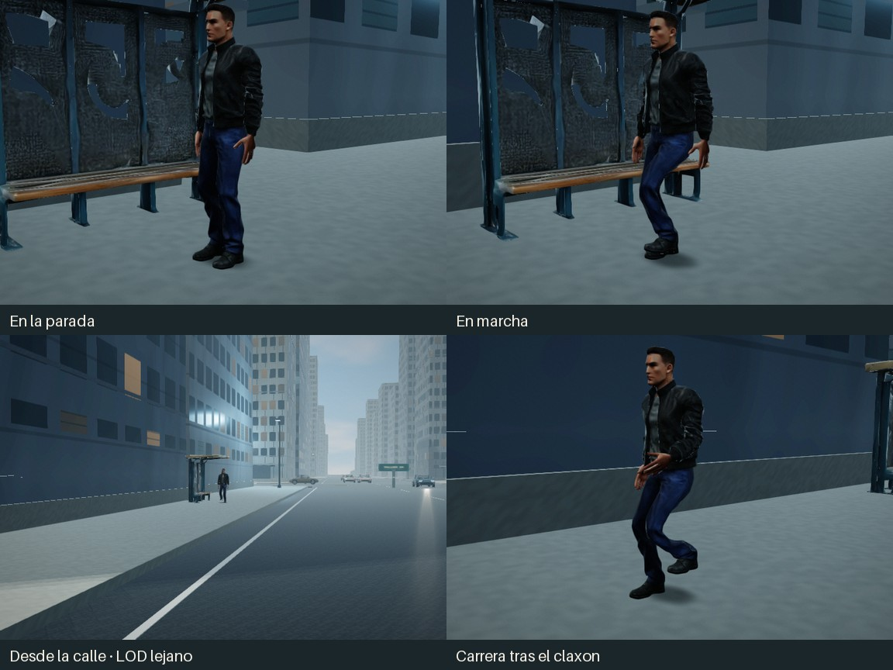
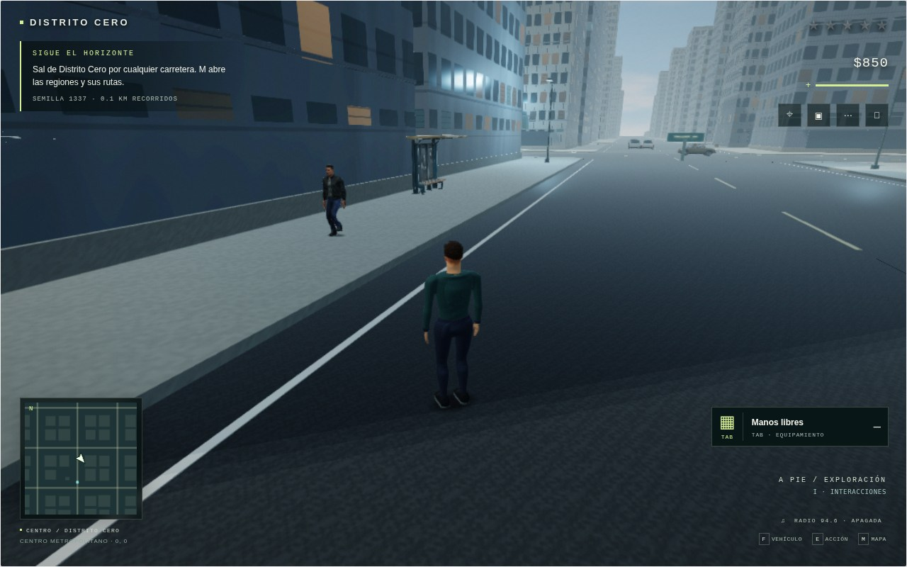
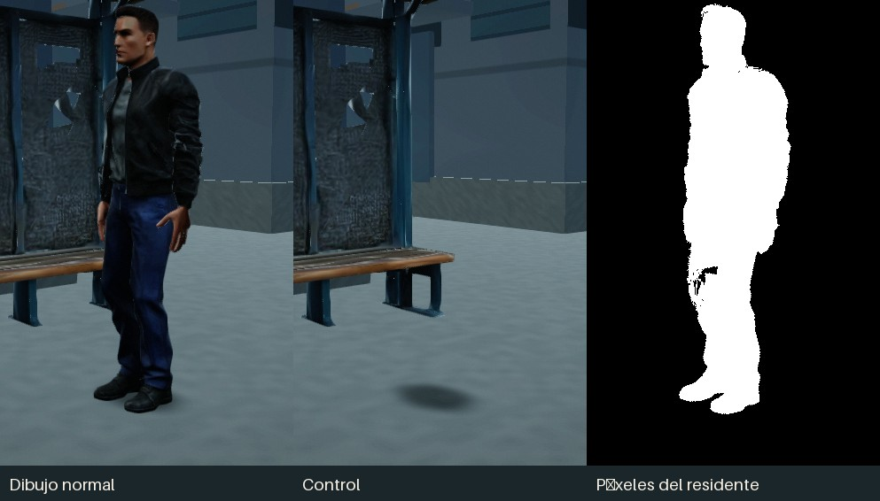

# El residente del Mercado en v0.20.29

El hombre de chaqueta negra espera junto a la marquesina del Mercado. Después camina por la acera y, si se acerca un vehículo y suena el claxon, sale corriendo. Las cuatro vistas proceden del juego en Chromium con WebGL2 y SwiftShader.



[Marcha en la acera](marcha.webp) · [Carrera tras el claxon](carrera.webp) · [Fotogramas, cámaras y mediciones](report.json)

## Desde la cámara del jugador



La partida de exploración llega al taller a pie. Desde allí, el ensayo aplica los controles de marcha y giro hasta el borde de la calzada. La cámara de seguimiento del juego usa el modo 0 y su campo de visión habitual de 64,8°. El HUD permanece visible. El mismo control de color confirma 1.790 píxeles del residente en la imagen de juego.

En una segunda aproximación, el jugador entra en la acera junto al residente. En la versión previa, la acera tapaba los zapatos del avatar modular. La comparación repite las mismas posiciones y la misma cámara después de incorporar el apoyo sobre las superficies de la calle. [Antes del ajuste](acera-avatar-antes.jpg) · [Con el ajuste](acera-avatar.jpg) · [Cámara y huella del control previo](acera-avatar-antes.json).

## Qué se midió

El ensayo crea una partida de la semilla 1337, entra en el coche inicial y utiliza el viaje al Taller del Mercado. Sigue al residente que ya pertenece al reparto de la partida, `ped:38`, desde su posición inicial (155,5 m, 130 m). La simulación avanza en pasos de 1/60 s. La cámara se sitúa a 3,4 m para ver la postura y después a 24,4 m para comprobar el cambio de malla. Una máscara por toma cuenta los píxeles que cambian al omitir solo el dibujo de color del residente. Se conservan la sombra, la cámara, la pose y el resto del mundo durante la comparación.



| Toma | Velocidad | Triángulos | Píxeles visibles |
| --- | ---: | ---: | ---: |
| Reposo | 0,00 m/s | 9.773 | 37.013 |
| Marcha | 1,35 m/s | 9.773 | 33.073 |
| Marcha, segundo instante | 1,35 m/s | 9.773 | 35.194 |
| Marcha, al otro lado de la calle | 1,35 m/s | 5.331 | 869 |
| Carrera | 3,78 m/s | 9.773 | 33.192 |

En reposo, la respiración cambia las matrices de los 49 huesos durante 0,75 s y el residente mantiene su posición. Durante la marcha, dos fotogramas separados por 0,35 s producen 14.579 píxeles distintos en el contorno, con una cámara que acompaña al actor. Tras el claxon a 19,94 m, el ensayo compara la paleta que llega al render con los tres clips a la misma fase y comprueba que la pose más próxima es Carrera. Las dos secuencias animadas contienen 14 fotogramas tomados a 12 por segundo de simulación.

En la segunda carga, el ensayo entrega al navegador un atlas dañado únicamente para este residente. El decodificador falla una vez y el juego representa al mismo peatón con 13 piezas del reparto genérico. Las lecturas de WebGL y la consola permanecen sin errores. El ensayo conserva la partida original y el almacenamiento y comprueba que ninguna toma solicita recursos HTTP o HTTPS. La cadencia de las animaciones exportadas corresponde al reloj de simulación.

## Reproducción

Instala las dependencias de [requirements-dev.txt](../../requirements-dev.txt) y usa una ruta de salida nueva. La herramienta guarda también los PNG de tamaño completo y la huella SHA-256 del HTML.

```sh
DC_QA_BROWSER=/usr/bin/chromium python3 tools/qa/capture_market_pedestrian.py \
  --html index.html --output artifacts/residente-mercado
```
