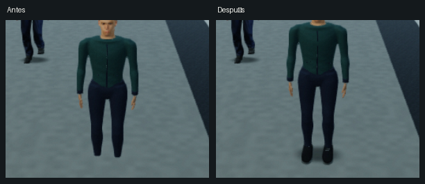

# Apoyo del jugador en la acera del Mercado

En la partida con semilla 1337, la cámara de juego muestra al jugador en X 156,8563 y Z 141,5992 m, junto al residente. En ese punto, la superficie superior del bordillo está a 0,150 m. Antes de la corrección, el punto más bajo de la suela estaba a 0,015 m. El zapato penetraba 13,5 cm en la acera. Con el ajuste queda a 0,150 m y la sombra de contacto a 0,153 m. La comparación conserva la cámara, la posición de ambos personajes, el ángulo del jugador, la fase y la altura local del rig.



La comprobación lee los vértices de la suela, la paleta de cuaterniones duales del jugador y las instancias que se envían a WebGL. Obtiene la cota de la acera de las cajas que realmente se subieron al búfer del sector. El recorte conserva los píxeles del navegador a su tamaño original.

## Acceso al sedán

Se coloca el sedán con la puerta sobre el mismo bordillo. La prueba activa y completa la interacción con F a 60 Hz. Mide la traslación del jugador en cada fotograma y la distancia entre la palma y el objetivo de la manilla mientras gira la puerta. Comprueba también la altura final del asiento y la diferencia entre los dos fotogramas contiguos al recuperar el control a pie. El primer ajuste producía un salto de 135 mm al empezar y terminar la interacción. En el HTML final, el cambio entre los dos fotogramas de cada límite es cero. El mayor incremento durante la aproximación es de 20,94 mm por fotograma y durante la salida, de 6,41 mm. La palma mantuvo el objetivo de la manilla con menos de 0,001 mm de error en los 43 fotogramas de contacto completo. El asiento conservó su cota de −0,29 m. La regresión de Node recorre además la cancelación durante el contacto con la manilla. [Mediciones de las tres versiones](mediciones.json)

## Reproducción

Las tres versiones corresponden al prototipo v0.20.29. Cada revisión conserva el HTML autónomo exacto de la prueba.

| Revisión de Git | Estado medido | SHA-256 de index.html |
| --- | --- | --- |
| 5b97127 | Alumbrado definitivo y jugador con los pies hundidos | 0fbc8b3cbed52d0058516ffe7f41895e2a5ff44c5df6e6be73d620285348f773 |
| a6eb9e9 | Apoyo en la acera y salto de altura al comenzar o terminar F | a82e8c1f73b2172cc3371c4462a9c7b3df065f43f515852793497069ed891609 |
| e291668 | Apoyo y acceso al sedán con transición continua | eea706081b10f04383614db3dd9456277dbb85e0a48ac69a056c2013f086b8eb |

Desde la raíz del repositorio, con Chromium, Playwright para Python y Pillow disponibles, ejecuta los siguientes comandos.

```sh
mkdir -p artifacts/contacto-acera
git show 5b97127:index.html > artifacts/contacto-acera/antes.html
git show a6eb9e9:index.html > artifacts/contacto-acera/intermedio.html
git show e291668:index.html > artifacts/contacto-acera/actual.html
DC_QA_BROWSER=/usr/bin/chromium python3 tools/qa/capture_player_surface.py \
  --before artifacts/contacto-acera/antes.html --intermediate artifacts/contacto-acera/intermedio.html \
  --after artifacts/contacto-acera/actual.html --output artifacts/contacto-acera
node --test tests/player-surface.test.cjs
```
