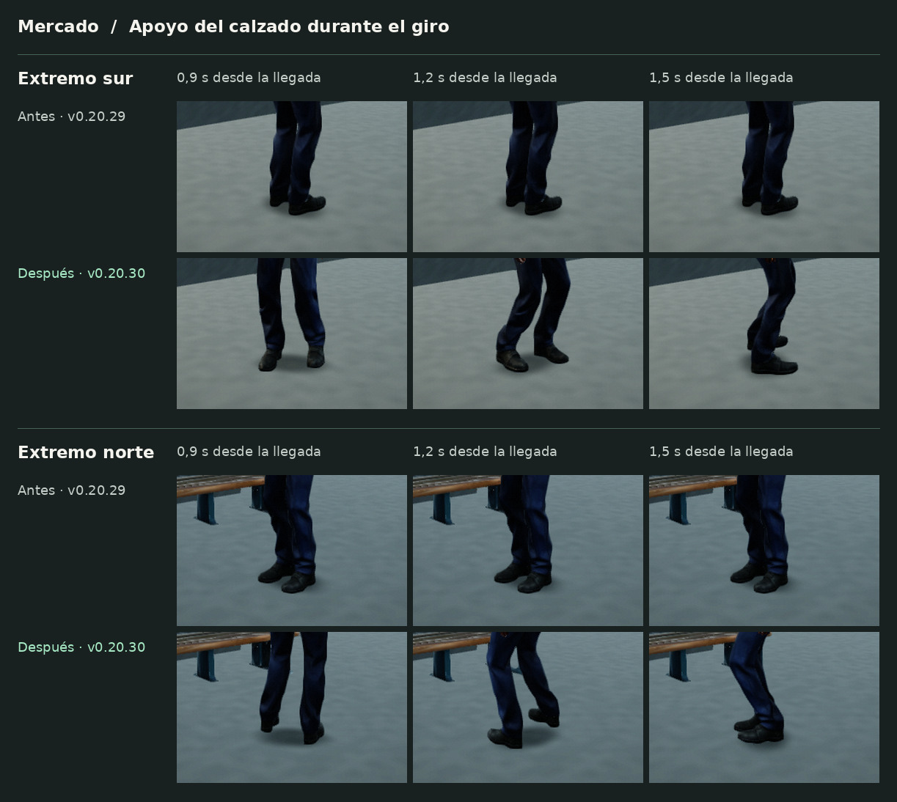

# El giro del residente en la acera del Mercado

[Ver las dos paradas en movimiento (MP4)](giro.mp4) · [Ver desde la cámara lejana](distancia.jpg)



El residente `ped:38` completa el recorrido de 19 m con la semilla 1337. Las filas superiores de cada comparación muestran v0.20.29 y las inferiores, v0.20.30. El contador parte de la llegada a cada extremo. A los 0,5 s comienza el giro de 1,4 s. El actor da cinco pasos alternos y termina de esperar hasta los 2,4 s antes de regresar por la misma acera.

## Medición en el juego

La prueba entra en el coche inicial y viaja al Taller del Mercado. La simulación mueve al residente y decide cuándo empieza cada giro. Las cámaras de inspección tienen línea de visión comprobada, campo vertical de 0,78 radianes y calidad equilibrada. La cámara cercana se sitúa a 2,81 m en planta del residente y la lejana, a 24,35 m. Cada distancia selecciona su malla a través del LOD del juego. Las imágenes proceden del HTML autónomo en Chromium con WebGL2 y SwiftShader.

Se siguen ambas suelas durante los 145 instantes de cada parada a intervalos de 1/60 s de simulación. Los archivos PNG de la cámara cercana recogen un fotograma cada seis intervalos. El MP4 sincroniza los 25 fotogramas de cada parada por versión. La cámara lejana muestra cada extremo a 1,2 s de la llegada. El perfilado de rendimiento en una GPU física queda pendiente.

La altura es la menor coordenada vertical de los vértices del zapato, relativa a la acera de 0,145 m. Nueve sondas del sector comprueban su plano alrededor de cada parada. Para el desplazamiento horizontal se sigue el centro de una misma región material de suela. En la pose de enlace se seleccionan las posiciones únicas dentro de los primeros 15 mm de altura del zapato. Cada posición se transforma con sus pesos, los datos del búfer de vértices, la fila de matrices y la instancia que usa el renderizador de calle.

### Apoyo durante los cinco pasos

El pie en vuelo alterna derecho, izquierdo, derecho, izquierdo y derecho. Cada intervalo dura 0,28 s. En cada intervalo se calcula la máxima distancia horizontal entre dos posiciones del pie opuesto, que sostiene el cuerpo. La elevación del pie en vuelo es su mayor separación vertical del pavimento. La versión anterior se compara en los mismos intervalos del reloj.

Valores en mm. Cada celda de apoyo muestra la mayor deriva entre los dos extremos.

| Malla | Versión | Apoyo 1 (I) | Apoyo 2 (D) | Apoyo 3 (I) | Apoyo 4 (D) | Apoyo 5 (I) | Elevación máxima del pie en vuelo |
| --- | --- | ---: | ---: | ---: | ---: | ---: | ---: |
| LOD0 | v0.20.29 | 102,7 | 1,0 | 0,0 | 0,0 | 0,0 | 0,1 |
| LOD0 | v0.20.30 | 0,70 | 0,07 | 0,10 | 0,07 | 0,03 | 52,0 |
| LOD1 | v0.20.29 | 119,1 | 1,1 | 0,0 | 0,0 | 0,0 | 0,3 |
| LOD1 | v0.20.30 | 0,69 | 0,07 | 0,10 | 0,07 | 0,03 | 53,4 |

### Llegada, giro y reposo

La siguiente medición cuenta el desplazamiento de una suela mientras permanece a 10 mm o menos de la acera. Incluye los primeros y últimos milímetros de despegue y aterrizaje. Se toma la máxima distancia horizontal dentro de cada episodio continuo de contacto y luego el máximo entre ambos pies, ambos extremos y ambos niveles.

| Intervalo desde la llegada | v0.20.29 | v0.20.30 |
| --- | ---: | ---: |
| 0–0,5 s · frenado | 224,3 mm | 55,6 mm |
| 0,5–1,9 s · giro | 144,9 mm | 20,5 mm |
| 1,9–2,4 s · reposo | 0,0 mm | 0,0 mm |

Por tanto, parte del deslizamiento visible al frenar persiste antes de que empiece el giro. La animación alterna los puntos de apoyo dentro de sus cinco fases. Los informes contienen por separado los resultados de cada pie y cada extremo. [Antes en LOD0](antes.json) · [Después en LOD0](despues.json) · [Antes en LOD1](antes-lod1.json) · [Después en LOD1](despues-lod1.json) · [Muestras por instante (JSON comprimido)](trayectorias.json.gz).

## Reproducir

El HTML anterior tiene SHA-256 `eea706081b10f04383614db3dd9456277dbb85e0a48ac69a056c2013f086b8eb`. La candidata tiene `c29717f5178dfff47f0a63b93b26c7d350b1d4e1eaab2e9a307aa70027b0df05`.

Se necesitan Python, Playwright, Pillow, Chromium, FFmpeg con libx264 y DejaVu Sans. Desde la raíz del proyecto se puede repetir la comparación con estos comandos. El verificador de los cinco apoyos debe fallar al aplicarlo también al control v0.20.29.

```sh
mkdir -p artifacts/giro
git show 6c96c61:index.html > artifacts/giro/v02029.html
export DC_QA_BROWSER=/usr/bin/chromium
python3 tools/qa/capture_market_turn.py --html artifacts/giro/v02029.html --output artifacts/giro/antes
python3 tools/qa/capture_market_turn.py --html index.html --output artifacts/giro/despues --require-turn
python3 tools/qa/capture_market_turn.py --html artifacts/giro/v02029.html --output artifacts/giro/antes-lod1 --far --snapshot-tick 72
python3 tools/qa/capture_market_turn.py --html index.html --output artifacts/giro/despues-lod1 --far --snapshot-tick 72 --require-turn
python3 tools/qa/compose_market_turn.py --before artifacts/giro/antes --after artifacts/giro/despues --far artifacts/giro/antes-lod1 artifacts/giro/despues-lod1 --output artifacts/giro/comparacion
(cd qa/market-turn-v02030 && sha256sum -c SHA256SUMS)
```

La prueba exige un giro continuo de la duración prevista en cada extremo, inversión del rumbo, raíz en el mismo punto, al menos 25 mm de elevación por paso y como máximo 5 mm de deriva y altura de la suela portante durante cada fase. [Captura](../../tools/qa/capture_market_turn.py) · [Muestreo de la piel en WebGL2](../../tools/qa/market_turn_stage.js) · [Composición de las imágenes](../../tools/qa/compose_market_turn.py).
