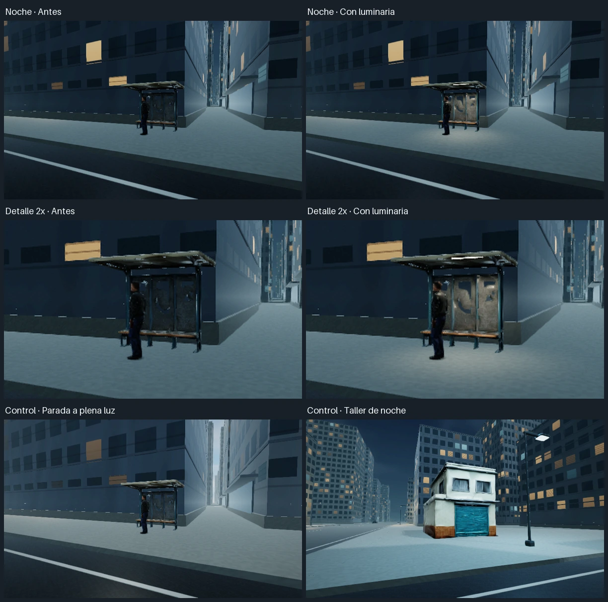

# La luz de la marquesina desde la calzada

La parada del Mercado está en (154,5 m, 130 m). La cámara observa al residente en reposo desde la calzada, a 7,62 m del centro de la cubierta y a 1,65 m sobre el asfalto. Las dos primeras filas comparan la misma escena nocturna. La segunda amplía el centro del encuadre al doble. La última muestra la parada de día y el taller de noche, visto desde 16,04 m.



En la vista nocturna la luminaria deja ver el panel perforado y el canto del banco detrás del residente. El contraste de la chaqueta con ese fondo sube un 93 %. Su luma mediana sube 2,85 niveles. En la cámara del taller, de día y de noche, ningún píxel cambió más de cuatro niveles en un canal. En la parada de día superan ese valor 110 de los 297.088 píxeles del encuadre.

| Zona de la parada de noche | Luma anterior | Luma con luz | Contraste anterior | Contraste con luz |
| --- | ---: | ---: | ---: | ---: |
| Banda de chaqueta | 7,72 | 10,57 | 20,29 | 39,15 |
| Residente completo | 8,74 | 11,36 | 22,73 | 38,41 |
| Marquesina | 28,50 | 63,89 | 11,79 | 25,60 |

Las cifras son medianas de luma sobre píxeles de pantalla, en una escala de 0 a 255. El contraste mide la diferencia absoluta respecto al fondo que quedaría visible al retirar la malla sólo del pase de color. Se miden los mismos píxeles en las cuatro exposiciones, identificados por una contribución superior a 4 en algún canal RGB. La banda de chaqueta cubre del 20 % al 55 % de la altura de la silueta, desde la cabeza hacia abajo. La paleta de los 49 huesos coincide en los dos HTML y en ambos ajustes de luz. [Mediciones y huellas de los HTML](mediciones.json)

## Reproducción

El menú de pausa ofrece el deslizador **Luz · noche a día**. Se capturan ambos extremos mediante ese control, con el reloj de simulación fijo en 1,25 s. Se usa el campo visual normal, calidad equilibrada, suelo seco y resplandor desactivado en Chromium con WebGL2 y SwiftShader. La imagen conserva la exposición y los colores del juego. [Control de la luz](../../src/frontier-ui.js) · [Capturador](../../tools/qa/capture_mercado_lighting.py)

Para reproducir la pareja medida, se extraen ambos HTML de los commits que contienen el mismo residente animado.

```sh
mkdir -p artifacts
git show 7155ff7:index.html > artifacts/mercado-luz-antes.html
git show 5b97127:index.html > artifacts/mercado-luz-despues.html
```

```sh
DC_QA_BROWSER=/usr/bin/chromium OPENBLAS_NUM_THREADS=1 python3 tools/qa/capture_mercado_lighting.py \
  --before artifacts/mercado-luz-antes.html --after artifacts/mercado-luz-despues.html --output artifacts/mercado-luz
```

## Comprobación tras el ajuste de apoyo

Se repitió la prueba con el mismo control `7155ff7` y el HTML `a6eb9e9`, que incluye el ajuste de altura del jugador sobre la acera. Coincidieron los conteos de píxeles, la paleta del residente, los valores de luma y contraste y los controles de toda la imagen en ambas cámaras. El contraste nocturno de la chaqueta volvió a pasar de 20,29 a 39,15 en los mismos 595 píxeles. La lámina de arriba corresponde a la pareja que aísla la instalación de la luminaria. El cambio posterior de entrada y salida del coche de `e291668` quedó fuera de este ensayo de iluminación estática.

Para repetir esta comprobación, usar `a6eb9e9:index.html` como segunda entrada del comando anterior. Su SHA-256 es `a82e8c1f73b2172cc3371c4462a9c7b3df065f43f515852793497069ed891609` y la huella del informe JSON producido es `2aab32f3179239137de19deb407291bd3e3385ed6471c0cb9592beaaeac32c06`.
