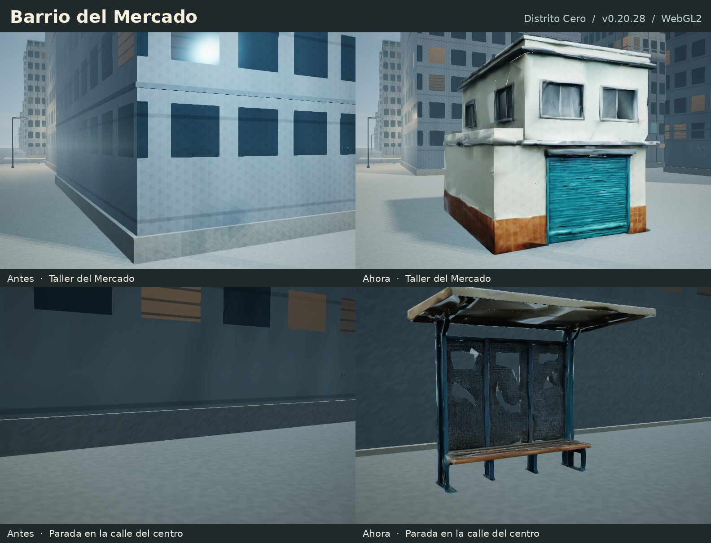

# Barrio del Mercado en WebGL2

La lámina compara las mismas dos cámaras en la semilla 1337. A la izquierda está la base v0.20.27, a la derecha la candidata v0.20.28. El taller ocupa la esquina de la parcela contigua al marcador de campaña. La marquesina del centro muestra el frente abierto y el banco de listones.

La captura ejecuta el HTML íntegro, sin peticiones HTTP, en Chromium con WebGL2. Lee el búfer de color del propio juego al terminar cada dibujo. Los cinco encuadres comprueban ambos frentes, la vista lateral y el nivel lejano de las paradas. El registro contiene la huella de cada HTML y el número de instancias dibujadas por nivel. [Cámaras e instancias](calle.json).

Los dos GLB del entorno se normalizaron a escala métrica y pasaron el validador oficial de Khronos. El directorio de fuentes conserva los tres mapas 4K por modelo. [Validación](gltf-validator.json) · [Receta y métricas](../../specs/mercado-3d/README.md).

La candidata pasó 25 comprobaciones durante cuatro ciclos de pérdida y recuperación de WebGL. El atlas volvió a cargarse en la misma sesión. [Informe de recuperación](recuperacion.json).
