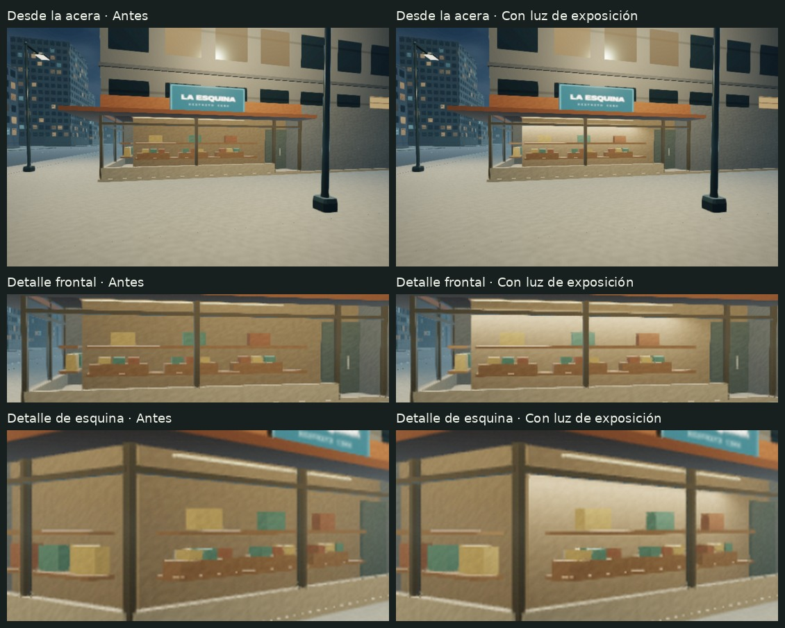

# La vitrina de la calle del Mercado al anochecer

El comercio de esquina de la semilla 1337 tiene su mostrador en X = 150,75 y Z = 185,21. Desde el banco de la marquesina, avanzar por la acera hasta el cruce siguiente. La tira de 5,4 m está sobre las dos baldas frontales. Al caer la tarde ilumina el fondo, las baldas y los paquetes. El alcance lateral acaba en la vitrina secundaria. Las superficies de madera y las cajas conservan su propio color.



## Qué se midió

Las imágenes salen del renderer del juego en WebGL2, con reloj fijo, calidad equilibrada, resolución de 768 × 480 y la misma exposición. En una segunda toma se ocultan sólo los quince paquetes, dejando su fondo y el cristal en la imagen. Para cada píxel de producto visible en ambas versiones se mide la diferencia absoluta de luma respecto al mismo píxel del fondo. La tabla compara las medianas en niveles de 0 a 255.

| Vista nocturna | Píxeles de producto compartidos | v0.20.30 | v0.20.31 | Variación |
| --- | ---: | ---: | ---: | ---: |
| Frontal | 2.549 | 17,70 | 23,98 | +35,5 % |
| Diagonal | 2.907 | 18,34 | 22,91 | +24,9 % |

En la toma frontal, el producto verde y el de terracota se distinguen por color y por silueta. El envase ocre de la balda superior aún tiene una luminosidad parecida a la del fondo claro.

La tira usa el punto más próximo de su longitud para iluminar el material de las piezas de exposición. La orientación de cada cara y la distancia al tubo determinan lo que recibe. La contribución desaparece con la luz de día y se desvanece entre 16 y 22 metros desde la cámara. Las demás luces de calle conservan sus posiciones y sus plazas.

En los 25 sectores de la toma urbana se conservan 22.992 instancias y 67 buffers. La toma frontal envía 446.038 triángulos en 80 llamadas instanciadas. La diagonal envía 428.722 en 76. Ambas versiones registraron los mismos valores. Se reutilizan los atributos de las cinco piezas estáticas de madera y fondo, las tres bandejas y los quince paquetes. El tratamiento añade el cálculo de una luz dirigida en los fragmentos de esas superficies cercanas por la noche. El perfilado de tiempo en GPU física sigue pendiente.

## Reproducir

Se requieren Python con NumPy, Pillow y Playwright, una fuente DejaVu Sans y Chromium con WebGL2. Desde la raíz del repositorio:

```sh
mkdir -p artifacts/vitrinas
git show 74c6df7:index.html > artifacts/vitrinas/antes.html
python3 build.py
node --test tests/street-corner-architecture.test.cjs tests/basic-material-program.test.cjs
DC_QA_BROWSER=/usr/bin/chromium python3 tools/qa/capture_shop_display.py \
  --before artifacts/vitrinas/antes.html --after index.html --output artifacts/vitrinas/comparacion
```

La comprobación recorre las cuatro orientaciones del edificio y sitúa el centro del tubo desde cada superficie. Los controles nocturnos del pueblo y de la marquesina, y ambas tomas diurnas del escaparate, deben coincidir píxel a píxel. El ensayo de las vitrinas prepara la escena con los coches y peatones fuera del encuadre. [Cámaras, huellas y mediciones](mediciones.json).
