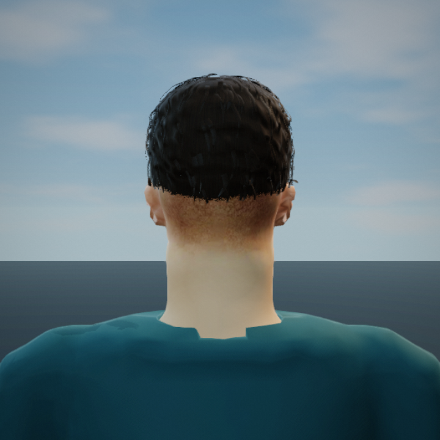
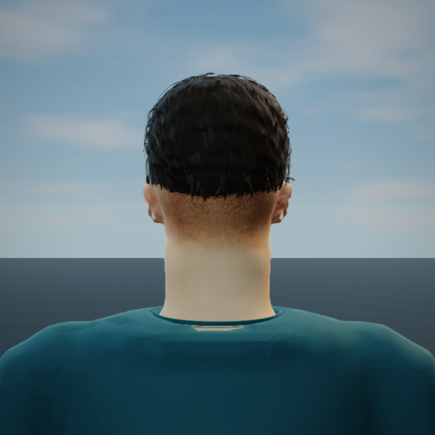
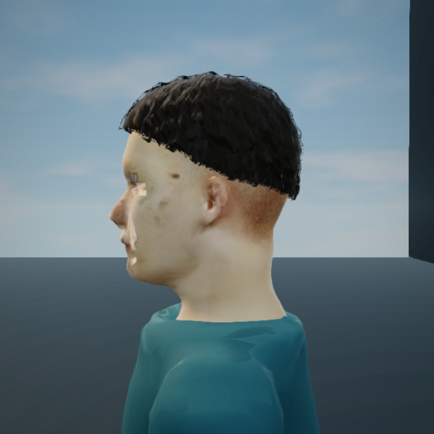
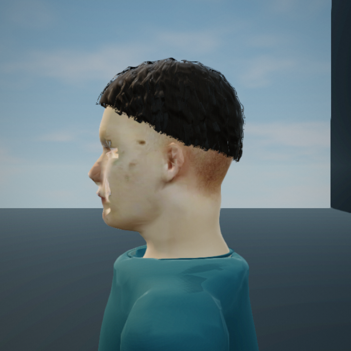
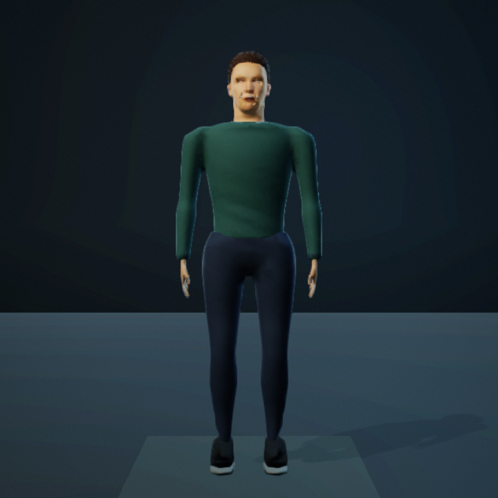

# Escote nativo en v0.20.27

La comparación usa dos HTML autónomos, una referencia de v0.20.25 y la candidata v0.20.27. El renderer de producción produjo 42 capturas por versión con cuatro perfiles, tres poses cervicales, tres niveles de detalle y seis vistas adicionales. La cámara posterior muestra la recuperación del ribete curvo del escote. En el centro inferior todavía se ve una franja de piel bajo el ribete. En la pose neutra, los rayos de la columna x=360 entre y=530 y 549 dan el mismo orden de piel y prenda en el LOD0 original y en el LOD2 corregido.

| Vista LOD2 | Antes | Después |
| --- | --- | --- |
| Nuca, reposo, luz neutra |  |  |
| Perfil, reposo, luz neutra |  |  |
| Cuerpo entero frontal, luz lateral |  |  |

El [informe compacto](summary.json) identifica el HTML, los productores, las imágenes y el alcance de las sondas. Cada ancla es el centro de una cara de la piel original. Se conservan sus identificadores al evaluar la prenda deformada por el shader. Los márgenes de separación miden distancia a lo largo de la normal de esa ancla. Una sonda que no alcanza la piel reducida queda sin clasificar.

## Resultados

Los 361 controles entre versiones pasan. La ejecución con la candidata sola, que usa CI, pasa sus 222 controles. Cada HTML pasó sus 130 controles de captura y 44 controles geométricos originales. Los 42 pares conservan la geometría de la cara y los 12 pares LOD0 conservan el PNG byte a byte. Las 42 imágenes y geometrías de v0.20.25 también reproducen las guardadas en su revisión.

| Medida | v0.20.25 | v0.20.27 |
| --- | ---: | ---: |
| Anclas con cobertura fuente perdida en las 12 condiciones | 841 | 0 |
| Anclas cubiertas fuera de la abertura delimitada por LOD0 | 4 | 0 |
| Rayos preseleccionados con la chaqueta delante de la piel LOD2 | 0/85 | 85/85 |
| Separaciones negativas sobre las mismas 3.755 muestras | 5 | 20 |
| Sondas sin intersección con la piel en esas 3.755 muestras | 492 | 492 |
| Menor separación en esas 3.755 muestras | −0,196 mm | −0,496 mm |

En las 4.596 muestras que cubre la fuente, los LOD1 y LOD2 restauran el mismo conjunto de anclas en las 12 condiciones. La chaqueta queda delante de la piel entre 9,33 y 37,68 mm en los 85 rayos fijados. En el ancla 9216, el margen llega a +20,80 mm en posterior y +18,45 mm en perfil. Los dos rayos históricos conservan +28,62 y +43,77 mm.

En el conjunto ampliado quedan 22 separaciones negativas y 495 sondas sin intersección con la piel reducida. La chaqueta LOD0 comparada con esa misma piel comparte el signo de las 22 separaciones. Al proyectar las 22 muestras por cinco cámaras, cuatro de los 110 rayos hacia el punto exacto pasan de prenda a piel. Los cuatro corresponden al ancla 9352 y la chaqueta fuente también deja la piel delante en esos rayos.

**Los 110 centros de píxel de las separaciones residuales coinciden con la fuente.** La primera versión de la reparación falló en la vista posterior del perfil ligero que gira a la derecha. El centro (293,536) mostraba piel allí donde la chaqueta fuente quedaba delante por 0,028 mm. La corrección conserva las celdas simétricas del ribete hasta 0,112 m de radio y recupera +0,028 mm de margen en ese centro. El control complementario del perfil ligero en reposo (465,527) conserva la abertura de la fuente. En esa vista la piel queda por delante de ambas chaquetas por 0,787 mm. En las cinco cámaras sólo el centro (465,527) pasa de chaqueta a piel frente a v0.20.25. Los cuatro rayos hacia el ancla exacta y los 110 centros de píxel evalúan posiciones distintas. En (293,536), el RGB nativo cambia de (125,139,130) en la primera reparación a (123,138,129) en la última. La lectura de LOD0 en el mismo píxel es (87,122,120). La identidad de la superficie en el centro procede de las profundidades de las geometrías nativas. El PNG 720 × 720 se presenta desde un buffer de 634 × 634 y el color del píxel incluye ese muestreo. El informe contiene las lecturas RGB y los márgenes de los dos centros.

## Reproducir la comparación

Se necesitan las dependencias de desarrollo declaradas en `requirements-dev.txt` y Chromium para Playwright. Los comandos siguientes admiten `--browser /ruta/a/chromium` en los dos pasos de captura. Las salidas se escriben en directorios nuevos. Para la candidata, usar el HTML construido en la revisión de este PR.

```sh
mkdir -p artifacts/neckline-inputs
git show ba9997df:index.html > artifacts/neckline-inputs/v02025.html
python3 build.py --check
python3 tools/qa/render_collar_lod.py --html artifacts/neckline-inputs/v02025.html --output artifacts/neckline-before --label old
python3 tools/qa/render_collar_lod.py --html index.html --output artifacts/neckline-after --label candidate
python3 tests/neckline_detail.test.py
python3 tools/qa/verify_neckline_detail.py --reference artifacts/neckline-before/report.json --candidate artifacts/neckline-after/report.json --output artifacts/neckline-comparison.json
```

El PR conserva el productor anterior y sus controles. El verificador adicional lee los dos informes completos, los PNG y las geometrías nativas. Comprueba la piel en todas las vistas, la imagen y geometría de LOD0, la cobertura direccional completa por perfil y pose y la profundidad frente a la piel LOD2. Las generaciones de CI se comparan internamente con su LOD0. La ejecución local con referencia externa añade las comparaciones entre versiones.

Las 85 muestras de profundidad se fijaron antes del cambio a partir de `visibility-verified.json` de la revisión anterior. Se incluyen todos los registros de `newlyUncoveredOutsideCore` con `newlyExposedPixelCenter` y con la chaqueta fuente delante de la piel reducida en ese píxel. Dos anclas proyectan sobre el mismo par condición–píxel, lo que da 84 pares distintos. El ancla 9216 tiene dos vistas de reposo neutro, posterior (263,524) y perfil (406,533). Se evalúan además los dos rayos históricos de la primera reparación y los dos centros de píxel del ancla 9352 que se fijaron en la primera revisión de esta candidata.

Las capturas usan poses preparadas y WebGL por software. La intersección de piel y tela en otros ángulos, la animación continua y el rendimiento físico exigen pruebas independientes.
