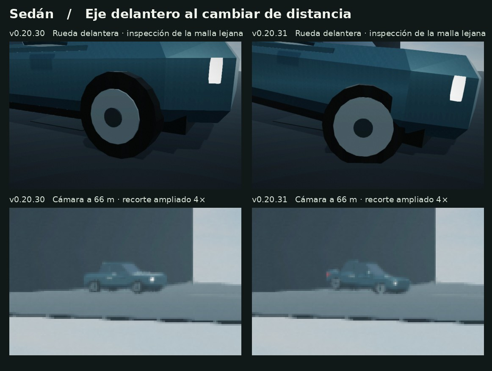

# Ejes del sedán en el cambio de detalle

El coche que se ve a partir de 66 m utilizaba cuatro cilindros con pivotes propios y orientación fija. Al cruzar el umbral en llano, el centro de un neumático saltaba hasta 73 mm. Con la suspensión de la prueba inclinada (cabeceo 0,09 rad y balanceo −0,065 rad), el salto alcanzaba 225 mm.

La carrocería lejana y los cuatro neumáticos siguen ahora la misma suspensión que la malla cercana. Las ruedas delanteras conservan el ángulo de dirección. Cada buje permanece sobre el eje del neumático durante la rodadura. En los dos ensayos el centro de cada rueda coincide en las dos mallas al cambiar el nivel de detalle. El neumático en ambos niveles mide 0,73 m de diámetro y 0,27 m de ancho.



La fila superior acerca la cámara al modelo que el renderer selecciona cuando el jugador está a 66,01 m. La inferior muestra un recorte de la cámara situada a esa distancia. Las cifras de desplazamiento corresponden a las posiciones en el mundo de las instancias que se envían al renderer. El coche simple conserva 12 instancias y 864 triángulos para sus cuatro ruedas. El [GLB distante](../../assets/dc-native-sedan-far.glb) incluye 30 piezas, 1.366 triángulos y cuatro ejes orientables. Sus materiales aproximan la presentación del juego. [Medidas y comparativas de píxel](medidas.json).

## Repetir

```sh
mkdir -p artifacts/ejes
git show 74c6df7:index.html > artifacts/ejes/v02030.html
DC_QA_BROWSER=/usr/bin/chromium python3 tools/qa/capture_sedan_axles.py --before artifacts/ejes/v02030.html --after index.html --output artifacts/ejes/recaptura
DC_QA_BROWSER=/usr/bin/chromium python3 tools/export_native_sedan.py --lod far --output artifacts/ejes/sedan-lejano.glb
cmp assets/dc-native-sedan-far.glb artifacts/ejes/sedan-lejano.glb
python3 tests/sedan_export.test.py
node --test tests/sedan-wheel-assembly.test.cjs
```
