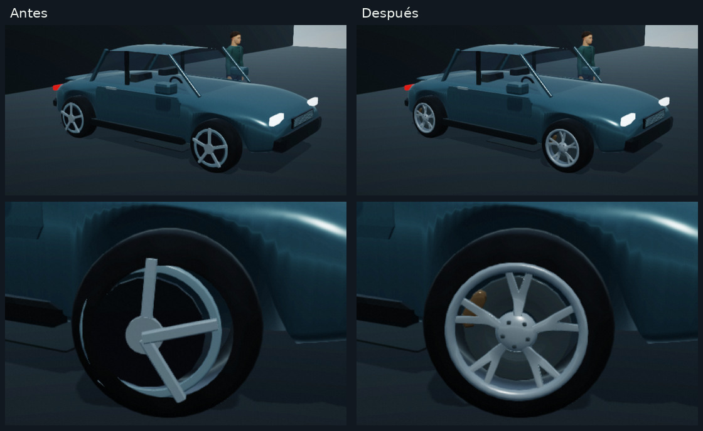

# Dirección y rodadura del sedán

La base colocaba los centros del aro y de los cinco radios en la carrocería. Al virar 0,42 radianes, el aro se separaba unos 55 mm de su punto de montaje en el eje delantero. En la vista oblicua parecía atravesar el neumático.

La rueda de aleación tiene cinco radios bifurcados con bisel, un cubo con cinco tornillos hexagonales, un disco de freno y una pinza. Los cuatro conjuntos comparten tres mallas procedurales originales, dibujadas en el mismo sistema de coordenadas que el neumático. El disco y la llanta giran con la rueda. La pinza acompaña la dirección y la suspensión al frenar y al rodar.

La [rueda descargable en GLB](../../assets/dc-sedan-wheel.glb) usa la geometría de producción, mide 0,73 m de diámetro y 0,27 m de ancho en el neumático. La raíz controla la dirección y el nodo `Rolling axle` controla la rodadura sobre X. Para regenerar el archivo ejecuta `node tools/export_sedan_wheel.cjs`.



## Coste por sedán

| Distancia al jugador | Instancias de las cuatro ruedas, antes → después | Triángulos de las cuatro ruedas, antes → después |
| --- | ---: | ---: |
| Cerca, detalle de frenado | 36 → 20 | 5.936 → 8.864 |
| Media, disco simplificado | 36 → 16 | 5.936 → 6.656 |
| A partir de 66 m | 12 → 12 | 864 → 864 |

El disco obtiene su geometría simplificada a 26 m en calidad equilibrada y alta, y a 16 m en económica. Las cifras cuentan instancias y triángulos enviados para las ruedas de un coche. El tiempo de GPU en dispositivos físicos queda por medir.

## Reproducir la revisión

Desde un checkout que contenga las fuentes de esta unidad, con Node, Python, Playwright, Pillow y Chromium disponibles, ejecutar estos comandos. El productor necesita un directorio de salida nuevo.

```sh
mkdir -p artifacts/wheel-input
git show e2e383c:index.html > artifacts/wheel-input/before.html
python3 build.py
node --test tests/sedan-wheel-assembly.test.cjs
python3 tools/qa/capture_vehicle_wheels.py --before artifacts/wheel-input/before.html --after index.html --output artifacts/wheel-review
```

Para usar un Chromium instalado localmente, definir `DC_QA_BROWSER` con la ruta del ejecutable. Las cuatro regresiones comprueban los ejes y pivotes finales que recibe el shader, la inmovilidad angular de la pinza respecto al portamangueta, los tres niveles de detalle y las dimensiones, normales y presupuesto de la geometría. La base falló las cuatro comprobaciones.

El estudio compara `e2e383c` con el HTML construido desde `69d4207`. La prueba WebGL2 usa Chromium 156 y SwiftShader, semilla 1337, salida de 800 × 500 y búfer de 704 × 440. Las siete vistas emparejadas cubren reposo, ambos sentidos de dirección, rueda trasera, suspensión inclinada y distancia. En el viraje delantero de +0,42 radianes cambiaron 37.216 píxeles RGB y en el control lejano cambiaron cero. La secuencia de conducción usa ocho muestras de cuatro pasos de simulación de 1/60 s, con aceleración y contravolante. El tiempo de reproducción corresponde a la simulación preparada.

[Secuencia de conducción](conduccion.webp) · [Informe con hashes, posiciones, mandos y diferencias de píxel](report.json)
