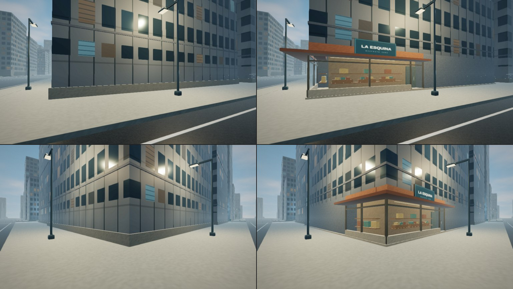
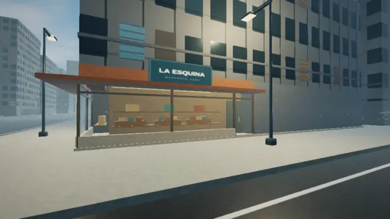

# Escaparates en las esquinas del distrito

La planta baja de un edificio urbano por manzana puede alojar un comercio con dos escaparates. La vitrina principal mide 9,60 m, el lateral 5,20 m y el fondo de exposición 1,12 m. El generador escoge una parcela por semilla y comprueba que tenga calles en ambos frentes. Las vitrinas quedan en la huella de colisión original y la puerta permanece cerrada. La marquesina deja 2,91 m de altura libre.

A la izquierda se ve la base `e2e383c` y a la derecha la candidata. La fila superior muestra el acceso y la inferior, el encuentro de los dos escaparates. Las capturas usan la misma semilla, cámara e iluminación en WebGL2.



El recorrido rodea la fachada desde la acera del acceso hasta el escaparate lateral. Sus trece posiciones de cámara permiten observar la profundidad de los estantes detrás de los montantes.



## Coste y alcance

La comparación utiliza la semilla 1337 y 25 sectores cargados en calidad equilibrada. La mercancía, el tirador y la luz de exposición suman 22 cajas por local cercano, dentro del lote dinámico existente. Su radio desde el ojo es de 52 m en calidad equilibrada y 30 m en económica. La envolvente y las baldas permanecen en los lotes estáticos del sector.

| Escenario | Base | Candidata |
| --- | ---: | ---: |
| Instancias estáticas en los 25 sectores del inicio | 21.364 | 23.003 |
| Lotes estáticos en los mismos sectores | 52 | 67 |
| Llamadas instanciadas por imagen, vista diagonal | 73 | 82 |
| Triángulos enviados por imagen, vista diagonal | 490.124 | 517.772 |
| Llamadas instanciadas por imagen, pueblo de control | 85 | 85 |
| Triángulos enviados por imagen, pueblo de control | 509.678 | 509.678 |

Los 1.639 registros adicionales ocupan 104.896 bytes de datos de instancia estáticos. Las llamadas y los triángulos incluyen los pases del renderer. La comparación se ejecutó en Chromium con SwiftShader, con reloj fijo y reparto controlado. El control rural coincide en los 589.824 píxeles. Las cifras de tiempo de cuadro en GPU física quedan pendientes de medición. [Cámaras y contadores por imagen](report.json)

## Reproducción

Desde un directorio limpio, con Python, Pillow, Playwright y Chromium disponibles:

```sh
mkdir -p artifacts/architecture-check
git show e2e383c:index.html > artifacts/architecture-check/base.html
python3 build.py
node --test tests/street-corner-architecture.test.cjs
python3 tools/qa/capture_street_architecture.py \
  --before artifacts/architecture-check/base.html --after index.html \
  --output artifacts/architecture-check/comparison --walk
```

El test recorre cuatro orientaciones de esquina y comprueba el volumen del escaparate, la altura bajo marquesina, el límite de detalle y su retirada al descargar un sector. La comparación visual toma cuatro cámaras urbanas y una rural a 1.024 × 576.
